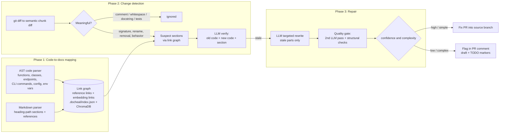

# DocHeal: Self-Healing Technical Documentation

[](https://github.com/hmoubarak72/self-healing-docs/actions/workflows/ci.yml)


**Every team's docs are always a little out of date.** DocHeal is a GitHub Action that watches
pull requests. When code changes make the docs wrong, it finds the **exact sections** that are now
wrong and then does one of two things:

* **auto-fixes** high-confidence cases (a renamed parameter, a changed default, a moved route) in a
  separate PR that targets your branch, or
* **flags** complex cases (a removed feature, a new required argument) for a human, with a suggested
  draft and `TODO` markers.

Every PR gets one sticky summary comment:

> **Doc Check Results:** 3 sections verified accurate, 2 auto-fixed (see #43), 1 flagged for review.

---

## How it works



| Phase | Module | What it does |
|---|---|---|
| 1.1 Code chunks | `docheal/code_parser.py` | Python AST to stable `path::qualname` chunks: functions, methods, classes, FastAPI/Flask endpoints, click/typer CLI commands and flags, config classes, `UPPER_CASE` constants, `os.getenv` keys. Records a **signature hash** and a **behavior hash** (the AST with docstrings removed). |
| 1.2 Doc sections | `docheal/doc_parser.py` | Splits markdown by heading into sections like `Configuration > Environment Variables`. Collects references from inline code, fenced blocks, `ENV_VARS`, `--flags`, and routes. |
| 1.3 Link graph | `docheal/graph.py` | Reference links (high precision, with document-frequency filtering for weak keys) plus embedding links (cosine similarity, top-k) using `text-embedding-3-small`, or an offline hashing embedder. |
| 1.4 Index | `.docheal/index.json` | The persisted graph. You can commit it, diff it, and query it. Embeddings can also be stored in a file-based **ChromaDB** store (`docheal index --chroma`). |
| 2.1–2.2 Diff | `docheal/diff.py` | Parses both sides of every changed file and classifies each chunk: `added`, `removed`, `signature_changed`, `behavior_changed`, `docstring_only`, `cosmetic`. Pairs renames by body similarity. Skips test files. |
| 2.3 Suspects | `docheal/pipeline.py` | Graph lookup for the old and new versions of each changed chunk, ranked by evidence (sections that literally contain an invalidated token come first). |
| 2.4 Verify | `docheal/llm.py` | The LLM gets the **old code, the new code, structured change facts, and the section**, and judges accuracy only. A missing doc for a new optional feature does not count as inaccurate. |
| 3.1–3.2 Repair + gate | `docheal/llm.py` | A surgical rewrite of only the stale statements, then a second LLM pass (accurate? preserved? same style?) plus model-independent structural checks: heading kept, stale token gone, edit stays local. |
| 3.3 Modes | `decide_mode()` | `auto_fix` if the change is simple, validated, and at or above `confidence-threshold`. Otherwise `review`, with `TODO (DocHeal)` markers. |
| 4 Action | `action.yml`, `Dockerfile`, `docheal/github_io.py` | Fix PR on the `docheal/fix-<pr>` branch (a single commit through the Git Data API, optional auto-merge) and a sticky PR comment. Outputs and a job summary are written for each run. |

### Two engines, one interface

* **LLM engine.** Uses Claude Sonnet (`anthropic-api-key`) or GPT-4o (`openai-api-key`). This is the
  production default.
* **Rule engine.** A deterministic engine that works from structured change facts (renames, default
  and value changes, removed options or routes, new required parameters). It runs with no API key:
  on forks, offline, and in tests. It also serves as the fallback if the LLM returns malformed output.

---

## Quick start

Copy [`examples/workflows/docheal.yml`](examples/workflows/docheal.yml) into `.github/workflows/`:

```yaml
on:
  pull_request:
    paths: ["**/*.py", "**/*.md"]
permissions:
  contents: write
  pull-requests: write
jobs:
  docs:
    if: ${{ !startsWith(github.head_ref, 'docheal/') }}
    runs-on: ubuntu-latest
    steps:
      - uses: actions/checkout@v4
        with: { fetch-depth: 0 }
      - uses: hmoubarak72/self-healing-docs@v1
        with:
          anthropic-api-key: ${{ secrets.ANTHROPIC_API_KEY }}
          confidence-threshold: "0.8"
```

### Inputs

| Input | Default | Description |
|---|---|---|
| `github-token` | `${{ github.token }}` | Needs `contents: write` and `pull-requests: write` |
| `anthropic-api-key` / `openai-api-key` | – | LLM and embedding keys. With neither key, the rule engine runs. |
| `llm-provider` | `auto` | `auto` \| `anthropic` \| `openai` \| `rules` |
| `model` | `claude-sonnet-5-5` / `gpt-4o` | Model override |
| `embedding-provider` | `auto` | `auto` \| `openai` \| `hashing` |
| `confidence-threshold` | `0.8` | Minimum confidence to auto-fix |
| `similarity-threshold` | auto | Cosine cut-off for embedding links |
| `auto-merge` | `false` | Squash-merge the fix PR when every fix is high-confidence |
| `mode` | `auto` | `auto` (fix PR + comment) \| `comment-only` |
| `code-paths` / `doc-paths` / `exclude` | `**/*.py` / `**/*.md` / – | Comma-separated globs |
| `max-sections` | `40` | Cost cap: the most suspect sections sent to the LLM per run |
| `fail-on-stale` | `false` | Fail the check when sections are flagged for review |

### Outputs

`stale-sections` (JSON), `corrections` (JSON), `stale-count`, `auto-fixed-count`, `flagged-count`,
`fix-pr-url`, `comment-url`, `report-path`, `summary`.

**Fork PRs** get a read-only token. In that case DocHeal still analyzes the change and lists the
fixes in the job summary, but it skips the fix PR. **Note:** PRs opened with `GITHUB_TOKEN` do not
trigger other workflows. If you want CI to run on fix PRs, pass a PAT or a GitHub App token as
`github-token`.

---

## Local CLI

```bash
pip install -e ".[dev,vector]"
docheal index --repo . --chroma                   # build .docheal/index.json (+ ChromaDB store)
docheal check --base origin/main                  # uncommitted + committed changes vs main
docheal check --base main --head feature --json   # a commit range, as JSON
docheal check --base main --apply                 # write high-confidence fixes to disk
```

## Docker build and Compose verification

```bash
docker compose build docheal          # builds the exact Action image (Dockerfile)
docker compose run --rm tests         # 28 unit + integration tests inside the image
docker compose run --rm benchmark     # labelled benchmark, fails if F1 < 0.9
docker compose run --rm demo          # simulates PR #42 against examples/sample_project
```

The `demo` service makes a feature branch with three kinds of change: a bumped default, a renamed
method, and a removed endpoint (plus comment-only noise). It runs the Action entrypoint the same way
GitHub would and prints the PR comment, the Action outputs, and the auto-fix diff. The output from the
last verification run is in [`verification/`](verification/).

---

## Accuracy (Phase 5)

### 1. Labelled suite: `examples/sample_project` (21 scenarios, rule engine)

| Precision | Recall | F1 | Mode accuracy | Correction quality |
|---|---|---|---|---|
| 1.00 | 1.00 | 1.00 | 1.00 | 1.00 |

The suite covers renamed parameters, methods, and classes; changed defaults, config fields,
constants, and env vars; route changes; CLI option and command renames; a removed endpoint and a
removed command; and a new required parameter. It also has **7 negatives** that must not be flagged:
comment-only, whitespace-only, docstring-only, and test-only edits, an internal refactor, a new
optional parameter, and a new function. The suite was written together with the engine, so read it
as a regression gate, not as proof that the engine generalizes. See
[`benchmarks/results/sample_rules.md`](benchmarks/results/sample_rules.md).

### 2. Held-out real repository: `encode/httpx@b5addb6` (7 scenarios, rule engine)

| Run | Precision | Recall | F1 |
|---|---|---|---|
| v0: first run, untuned | 1.00 | 0.44 | 0.62 |
| v1: after two generic fixes | **1.00** | **0.89** | **0.94** |

The two fixes were (a) evidence-weighted ranking of suspects, because the `follow_redirects` rename
touched 97 sections and the true positives were being cut off by the cap, and (b) diffing defaults at
the level of individual literals, so a change to `Limits(..., max_keepalive_connections=20)` is
detected even though the doc says "(Defaults 20)" on the next line. The one remaining miss is real:
changing `Timeout(timeout=5.0)` makes the prose "*raise a `TimeoutException` after 5 seconds*" stale.
Catching that takes semantic reading, which is what the LLM engine is for. Results are in
[`benchmarks/results/`](benchmarks/results/).

Rerun the benchmarks with an LLM:
`python -m benchmarks.run --provider anthropic` and
`python -m benchmarks.real_repo --clone --provider anthropic`.

---

## Project layout

```
docheal/            core package (parsers, graph, diff, facts, engines, pipeline, GitHub I/O, CLI)
action.yml          Action definition (inputs, outputs, docker runtime)
Dockerfile          Action image (python:3.12-slim + git + docheal [+ chromadb])
docker-compose.yml  local verification: tests, benchmark, demo
benchmarks/         labelled suite, real-repo (httpx) benchmark, results
examples/           sample project used by the demo and benchmarks, plus a consumer workflow
tests/              pytest suite (28 tests)
.github/workflows/  CI, dogfooding, and a release workflow (GHCR image + moving v1 tag)
```

## Limitations and roadmap

* Python code only for now. The parser sits behind a small interface, and TypeScript is next.
* Markdown docs only (no reStructuredText or Sphinx yet).
* Changes to behavior alone (no signature change) need the LLM engine. The rule engine only catches
  them when a single literal changed.
* Marketplace: tag `v1.0.0` and publish through *Releases → Publish this Action to the GitHub
  Marketplace*. `release.yml` publishes a prebuilt GHCR image, and you can point `runs.image` at it
  for faster cold starts.

## License

MIT © Hesham Moubarak
